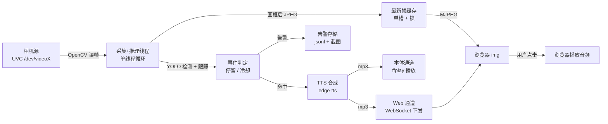

# PRD：相机目标识别 · Web 推流 · 语音播报系统

| 项 | 内容 |
|---|---|
| 项目代号 | EyeSentry（暂定，可随时改） |
| 文档版本 | v1.0 |
| 日期 | 2026-10-22 |
| 作者 | 欧阳凯 |
| 状态 | 决策已确认，可进入实施 |
| 目标读者 | 本人（开发者）· 同事朋友（复现者）· 公开平台读者（学习者） |
| 关联文档 | [GLOSSARY.md](./GLOSSARY.md) · [ADR-0001](./docs/adr/0001-uvc-only-rgb-phase-one.md) · [ADR-0002](./docs/adr/0002-mjpeg-now-webrtc-later.md) |

---

## 1. 一句话说明

摄像头画面在边缘设备上被实时检测，带检测框的画面推到浏览器；当有人在同一位置停留超过 5 秒，浏览器和设备本体喇叭同时用中文语音提醒你。

---

## 2. 背景与问题

**背景**：手上有一台 Orin、几台深度相机（RealSense D405/D435、奥比中光 335Lg），想做一个能跑在自己设备上、也能讲给别人听的视觉应用。

**问题**：
1. 现有方案要么是厂商 Demo（只能看，不能改），要么是云端服务（要上传画面、要联网、要钱）。
2. 想验证「检测 + 事件 + 语音」这条链路在自己硬件上的真实表现，缺一个可复现的最小工程。
3. 想让同事/朋友照着文档半小时内跑起来，缺一份说清前提、步骤和坑的文档。

**为什么现在做**：硬件在手，YOLO 与 TTS 的现成能力足够撑起一个完整闭环，不需要训练模型、不需要标注数据。

---

## 3. 目标与非目标

### 3.1 目标（按优先级）

| 优先级 | 目标 | 判断标准 |
|---|---|---|
| P0 | 画面能稳定从相机流到浏览器 | 720p、≥15fps、端到端 ≤2s |
| P0 | 能识别人与常用物品并画出框 | 检测框与标签正确跟随目标 |
| P0 | 有人停留 5 秒能触发播报 | 20 次走位测试，触发准确率 ≥90% |
| P0 | 播报同时到达网页与本体喇叭 | 两路可独立开关，触发到出声 ≤3s |
| P1 | 换一台机器（Mac/Windows）能跑同一套代码 | 只改配置，不改代码 |
| P1 | 告警有留痕可回看 | 时间、截图、人数可见 |
| P1 | 别人能按文档复现 | 新人 30 分钟内出画面 |

### 3.2 非目标（一期明确不做）

- 不做模型训练与微调，只用官方预训练权重。
- 不做多路相机并发、不做多设备协同。
- 不做视频存储与历史回放，只存告警截图。
- 不做账号、权限、公网暴露。
- 不做深度显示、不做 GMSL 接入（二期）。
- 不做手机推送、不做报表统计。

---

## 4. 用户与场景

| 用户 | 场景 | 关心什么 |
|---|---|---|
| 我自己（学习者） | 在家里/工位对着书桌或门口架相机，边写边调 | 每一步能否立即看到结果 |
| 同事、朋友（复现者） | 拿到文档和仓库，在自己电脑上跑一遍 | 装依赖会不会卡住、报错看不看得懂 |
| 公开读者（学习者） | 在 GitHub / 掘金 / 知乎读方案 | 选型理由、架构、踩过的坑 |

**典型使用流程**：插相机 → 改一行配置指向设备节点 → 启动服务 → 浏览器打开页面 → 点击一次开启声音 → 人站到画面里 5 秒 → 听到播报、右侧出现一条告警。

---

## 5. 功能需求

标记说明：**P0** 一期必须；**P1** 一期尽量；**P2** 二期。

### 5.1 相机接入

| 编号 | 优先级 | 需求 |
|---|---|---|
| F-01 | P0 | 通过配置文件指定唯一相机源（Linux 用设备路径如 `/dev/video4`，Mac/Windows 用索引如 `0`） |
| F-02 | P0 | 启动时枚举本机所有视频设备，并打印每个节点支持的像素格式与分辨率，供人判断哪个是彩色流 |
| F-03 | P0 | 配置的相机源无效或打不开时，启动失败并给出明确提示 + 可用设备清单，不静默降级 |
| F-04 | P0 | 打开相机后校验实际分辨率与帧率，与配置不符时打印警告但继续运行 |
| F-05 | P0 | Web 页面顶部显示当前相机源、实际分辨率、实际帧率（只读） |
| F-06 | P1 | Web 页面下拉切换相机，切换时释放旧设备、打开新设备，允许 1~2 秒黑屏 |
| F-07 | P2 | 支持 GMSL 接口的奥比中光 335Lg（需解串板） |

> **关键认知（必须写进文档）**：一台 RealSense 会暴露 5~6 个 `/dev/videoX`，分别是深度、红外、彩色与元数据流，**不是多台相机**。彩色节点通常同时支持 `YUYV` 与 `MJPG`，其余节点是 `Z16` 或 `GREY`。用 `v4l2-ctl --list-formats-ext -d /dev/videoX` 逐个看即可确认。真正插了多台相机时，才存在「选哪一台」的问题。

### 5.2 实时推流

| 编号 | 优先级 | 需求 |
|---|---|---|
| F-08 | P0 | 服务端输出带检测框的 MJPEG 流，浏览器用单个 `` 即可显示 |
| F-09 | P0 | 浏览器断开后服务端不中断推理，重连即恢复画面 |
| F-10 | P0 | 画面左上角显示实时推理帧率，便于判断算力余量 |
| F-11 | P1 | 页面支持暂停/继续画面（仅前端停订阅，不打断推理） |
| F-12 | P2 | 提供 WebRTC 播放通道，与 MJPEG 二选一（见 ADR-0002） |

### 5.3 目标检测

| 编号 | 优先级 | 需求 |
|---|---|---|
| F-13 | P0 | 使用官方预训练 YOLO 权重做推理，不在端侧训练 |
| F-14 | P0 | 默认检测白名单：人 + 常用物品（猫、背包、瓶子、杯子、椅子、笔记本、手机、书、时钟） |
| F-15 | P0 | 检测框显示中文类别名与置信度（如「人 0.87」），框色按类别区分 |
| F-16 | P1 | Web 页面可勾选/取消类别，变更后 3 秒内生效，不需重启 |
| F-17 | P1 | 置信度阈值可在配置中调整，默认 0.4 |

### 5.4 停留事件判定

| 编号 | 优先级 | 需求 |
|---|---|---|
| F-18 | P0 | 对白名单内目标做跨帧跟踪，为每个人分配跟踪 ID |
| F-19 | P0 | 同一跟踪 ID 连续存在 ≥5 秒，判定为一次停留事件 |
| F-20 | P0 | 允许目标短暂消失（默认 2 秒内）仍视为连续，抵抗单帧漏检 |
| F-21 | P0 | 同一跟踪 ID 触发后进入 30 秒冷却窗口，期间不重复触发 |
| F-22 | P0 | 多人同时满足时合并为一条播报，文案含人数 |
| F-23 | P1 | 画面为每个已跟踪的人显示其已停留秒数，便于自测 |
| F-24 | P1 | 停留阈值与冷却时长可在配置中调整 |

### 5.5 语音播报

| 编号 | 优先级 | 需求 |
|---|---|---|
| F-25 | P0 | 触发时生成中文播报音频，默认文案「检测到 N 人停留超过 5 秒」 |
| F-26 | P0 | 同一次触发只合成一次音频，分发给两个 TTS 通道 |
| F-27 | P0 | Web 通道：浏览器收到告警后自动播放该音频 |
| F-28 | P0 | 本体通道：设备声卡播放同一音频 |
| F-29 | P0 | 两路通道各自有开关（页面上的软件开关），默认全开，状态在本次会话内保持 |
| F-30 | P0 | 浏览器首次进入需点击一次解锁音频，页面给出明确提示，不静默失败 |
| F-31 | P1 | 播报文案模板可配置，变量支持 `{n}` 人数、`{dwell}` 阈值秒数 |
| F-32 | P1 | TTS 合成失败时降级：Web 通道改用浏览器内置语音，本体通道播放提示音 |
| F-33 | P2 | 本体喇叭物理开关 |

### 5.6 告警留痕

| 编号 | 优先级 | 需求 |
|---|---|---|
| F-34 | P0 | 每次停留事件生成一条告警：时间戳、人数、带框截图 |
| F-35 | P0 | 页面右侧列表倒序显示最近 50 条，新条目高亮 |
| F-36 | P0 | 点击告警可查看大图截图 |
| F-37 | P1 | 截图文件落盘保留最近 200 张，超出按时间清理 |

### 5.7 运行与配置

| 编号 | 优先级 | 需求 |
|---|---|---|
| F-38 | P0 | 全部可调参数集中在一个 `config.yaml`，不散落在代码里 |
| F-39 | P0 | 服务启动后可被局域网内其他设备访问（同网段输入 `http://<设备IP>:8000`） |
| F-40 | P0 | 同一套代码在 Orin（Linux）、macOS、Windows 上运行，差异只在配置与音频播放命令 |
| F-41 | P1 | 提供 Docker 方式在 Orin 上运行，容器内可用相机与声卡 |
| F-42 | P1 | 提供 systemd 服务文件，开机自启、崩溃重启 |
| F-43 | P1 | 上层只通过 `for jpeg, boxes in stream` 消费画面与检测结果，不直接调用相机与推理库；相机归属由 stream 内部决定（见 7.8） |
| F-44 | P2 | 提供 C++ 侧车实现，通过配置 `detector.backend: cpp` 切换，上层零改动 |

---

## 6. 用户故事

1. 作为一个学习者，我想只改一个配置项就指定相机，以便不用读代码就能换设备。
2. 作为一个学习者，我想启动时看到所有视频节点及其格式，以便判断哪个是彩色流。
3. 作为一个学习者，我想配置错设备时立刻看到明确报错和候选列表，以便不用猜。
4. 作为一个使用者，我想在浏览器里直接看到画面，以便不用装任何客户端。
5. 作为一个使用者，我想看到画面上的检测框和中文标签，以便知道系统到底认出了什么。
6. 作为一个使用者，我想看到实时帧率，以便判断设备算力是否够用。
7. 作为一个使用者，我想让人站 5 秒才触发，以便路过不会被误报。
8. 作为一个使用者，我想同一个人不重复播报，以便不被吵到。
9. 作为一个使用者，我想两人同时停留时听到「检测到 2 人」，以便一次听清人数。
10. 作为一个使用者，我想在网页上关掉声音，以便开会时不打扰别人。
11. 作为一个使用者，我想在设备上关掉喇叭，以便只有远程的人听到。
12. 作为一个使用者，我想网页和设备同时响，以便不在电脑前也知道有人来了。
13. 作为一个使用者，我想第一次进页面被提示「点击开启声音」，以便知道为什么没声音。
14. 作为一个使用者，我想右侧看到告警列表和截图，以便事后确认刚才发生了什么。
15. 作为一个使用者，我想点开告警看大图，以便核对细节。
16. 作为一个使用者，我想刷新页面后画面立刻恢复，以便不用重启服务。
17. 作为一个使用者，我想换台电脑只改配置就能跑，以便在 Mac 上继续调。
18. 作为一个使用者，我想在局域网用手机打开页面，以便把手机当监视器。
19. 作为一个复现者，我想按文档一步步装依赖，以便不踩环境坑。
20. 作为一个复现者，我想看到每一步的验证命令，以便确认这步真的成功了。
21. 作为一个复现者，我想知道硬件前提（USB3 线、解串板），以便不买错东西。
22. 作为一个复现者，我想看到常见报错及处理办法，以便自己解决。
23. 作为一个公开读者，我想看到为什么选 MJPEG 而不是 WebRTC，以便理解取舍。
24. 作为一个公开读者，我想看到架构图和模块职责，以便看懂整体结构。
25. 作为一个公开读者，我想看到哪些事没做，以便判断这个方案的边界。
26. 作为一个开发者，我想算法参数集中在配置里，以便调阈值不用改代码。
27. 作为一个开发者，我想推理与 Web 服务分离，以便浏览器断开不影响检测。
28. 作为一个开发者，我想音频只合成一次，以便两路播报不重复调用接口。

---

## 7. 技术方案

### 7.0 语言与运行时

**主体是 Python，前端是 HTML/CSS/JavaScript，两者不可替换。** 其余都是配置文件和几十行脚本，不构成技术选型。

| 层 | 语言 | 说明 |
|---|---|---|
| 相机采集、推理、跟踪、事件判定 | Python 3.10+（Orin JetPack 5 上的 3.8 也可） | ultralytics、OpenCV、FastAPI 都是一等公民 |
| Web 服务与 MJPEG 输出 | Python | FastAPI + uvicorn，生成器直接吐字节 |
| 播报合成与设备播放 | Python（调用 `edge-tts`、`ffplay`） | 外部命令用 subprocess 调，不写 C |
| 页面 | HTML + CSS + 原生 JavaScript | 浏览器只认这一种，单文件约 150 行 |
| 配置 | YAML | 手改，不需要代码 |
| 部署 | Bash（systemd unit）+ Dockerfile | 各一份，几十行 |

**为什么不是别的语言**：

| 语言 | 结论 | 原因 |
|---|---|---|
| Python | 采用 | YOLO 训练/推理/跟踪的官方支持与教程密度压倒性；OpenCV 绑定最成熟；同样功能代码量最少 |
| C++ | 不用（一期） | 省掉 torch 依赖、可崩溃隔离、前处理开销略低，但代码量是 Python 的 5~10 倍，且与「看得懂、能分享」的目标冲突 |
| Node.js | 不用 | 视觉与推理生态是 Python 的，Node 侧只能当转发层，白白多一层 |
| Go / Java / Rust | 不用 | OpenCV 与 YOLO 绑定弱或缺失，等于自己重造轮子 |

**性能不够时不需要换语言**：把模型导出成 TensorRT engine（`model.export(format="engine")`），仍由 Python 调用，即可拿到数倍加速。换语言是最后手段，不是第一步。

### 7.1 架构



**一条主线**：一个后台线程做「采集 → 推理 → 跟踪 → 判定 → 画框 → 写缓存」，Web 层只做两件事：把缓存里的最新帧吐成 MJPEG，把告警通过 WebSocket 推给页面。这样浏览器来去都不影响推理。

### 7.2 技术栈与选型理由

| 环节 | 选择 | 理由 | 放弃的方案 |
|---|---|---|---|
| 相机读取 | OpenCV `VideoCapture`（UVC） | 三平台一套代码；RealSense 彩色流本身走 UVC；避开 Jetson 上编译 pyrealsense2 | pyrealsense2、Orbbec SDK（见 ADR-0001） |
| 检测 | Ultralytics YOLOv8n | 一条 `pip install` 可用，自带跟踪器与导出工具，教程最多 | YOLOv11n（生态略少）、RT-DETR（更重） |
| 跟踪 | ByteTrack（Ultralytics 内置） | 零额外依赖，`model.track()` 直接拿到持久 ID | BoT-SORT（更准但参数更多）、自写 IoU 匹配（不稳） |
| 推流 | MJPEG | 后端一行生成器、前端一个 ``，无信令无编解码协商 | WebRTC（二期，见 ADR-0002）、HLS（延迟大）、RTSP-Web（需插件/转码） |
| Web 后端 | FastAPI + uvicorn | 异步流式响应简单，自带接口文档 | Flask（流式需额外处理）、Django（过重） |
| 前端 | 原生 HTML/CSS/JS 单文件 | 约 150 行，不引框架，改起来没有构建步骤 | React/Vue（增加构建链，对本项目无收益） |
| TTS | edge-tts | 免费、中文自然、`pip install` 即用 | 云厂商 TTS（要密钥要计费）、Piper（完全离线但音质一般）、pyttsx3（中文机械音） |
| 本体播放 | `ffplay -nodisp -autoexit` | 直接播 mp3，三平台一致（需装 ffmpeg） | aplay（仅 wav）、winsound（仅 Windows、仅 wav） |
| 告警存储 | JSONL + 截图文件 | 无数据库，重启能读回，方便肉眼检查 | SQLite（对 50 条记录是过度设计） |
| 部署 | 裸机 venv 为主，Docker 可选 | 容器里直通相机与声卡是最容易卡住的一环 | 仅 Docker（音频直通成本高） |

### 7.3 模块划分（5 个文件，各自职责单一）

| 文件 | 职责 | 对外暴露 |
|---|---|---|
| `camera.py` | 枚举设备、打开相机、读帧、格式自检 | `list_devices()`、`Camera.open()`、`Camera.read()` |
| `detector.py` | YOLO 推理与跟踪、停留判定、画框 | `Detector.process(frame) -> Annotated`、`DwellTracker.update(tracks, now)` |
| `tts.py` | 文案渲染、音频合成、双通道播放 | `speak(text, channels)` |
| `main.py` | 线程启动、帧缓存、HTTP/WS 路由、静态页挂载 | 应用入口 |
| `config.yaml` | 全部可调参数 | — |

`static/index.html` 单文件承载页面，CSS/JS 内联。

### 7.4 接口约定

| 方法 | 路径 | 用途 | 返回 |
|---|---|---|---|
| GET | `/` | 页面 | HTML |
| GET | `/stream` | MJPEG 流 | `multipart/x-mixed-replace` |
| GET | `/api/status` | 相机信息、帧率、通道开关状态 | JSON |
| GET | `/api/alerts?limit=50` | 告警列表（倒序） | JSON 数组 |
| GET | `/api/alerts/{id}/snapshot.jpg` | 告警截图 | JPEG |
| POST | `/api/settings` | 修改白名单 / 通道开关 / 阈值 | JSON |
| GET | `/audio/{name}.mp3` | 播报音频 | audio/mpeg |
| WS | `/ws/alerts` | 实时推送告警与播放指令 | JSON 帧 |

告警 JSON 结构（契约，前端按此渲染）：

```json
{
  "id": "20261022-223105-3",
  "ts": "2026-10-22T22:31:05+08:00",
  "people": 2,
  "dwell_seconds": 5.0,
  "text": "检测到 2 人停留超过 5 秒",
  "audio_url": "/audio/20261022-223105-3.mp3",
  "snapshot_url": "/api/alerts/20261022-223105-3/snapshot.jpg"
}
```

### 7.5 停留判定算法（核心逻辑，先写清楚再写代码）

```text
每帧:
  tracks = YOLO.track(frame, persist=True, classes=白名单)
  对每个轨道 t:
    if t.id 首次出现: first_seen[t.id] = now; last_seen[t.id] = now
    else: last_seen[t.id] = now

  对每个轨道 t:
    if now - first_seen[t.id] >= 5.0
       and now - last_trigger.get(t.id, -inf) >= 30.0:
        待触发集合.add(t)
        last_trigger[t.id] = now

  清理: 若 now - last_seen[t.id] > 2.0，删除该轨道的 first_seen / last_trigger
         （离开画面超过 2 秒即重新计时）

  if 待触发集合非空:
    合并成一条事件: people = len(待触发集合)
    emit DwellEvent(people)
```

三个参数（阈值 5s、冷却 30s、丢失容忍 2s）全部来自 `config.yaml`。

### 7.6 配置样例

```yaml
camera:
  source: /dev/video4      # Linux/Orin 用路径；macOS/Windows 用 0
  width: 1280
  height: 720
  fps: 15                  # 设备固件常固定 30fps，由 stream 按此值节流
  fourcc: MJPG             # 高分辨率下优先 MJPG，否则带宽吃紧

detector:
  backend: python          # python | cpp（二期侧车，见 7.8）
  model: yolov8n.pt        # 首次运行自动下载约 6MB
  conf: 0.4
  imgsz: 640               # 帧率不足时降到 416
  classes: [0, 15, 24, 39, 41, 56, 63, 67, 73, 74]

dwell:
  seconds: 5.0
  cooldown_seconds: 30
  lost_tolerance_seconds: 2.0

tts:
  engine: edge
  voice: zh-CN-XiaoxiaoNeural
  template: "检测到{n}人停留超过{dwell}秒"
  channels:
    web: true
    device: true

server:
  host: 0.0.0.0
  port: 8000

storage:
  alert_dir: ./data/alerts
  max_snapshots: 200
  max_alerts_in_page: 50
```

`classes` 用的是 COCO 类别编号：0 人、24 背包、39 瓶子、41 杯子、56 椅子、63 笔记本、67 手机、73 书、74 时钟。

### 7.7 运行方式

**路径 A：裸机 venv（推荐，先跑通这个）**

```bash
python3 -m venv .venv && source .venv/bin/activate
pip install -r requirements.txt
python main.py            # 浏览器打开 http://<设备IP>:8000
```

**路径 B：Docker（Orin 上长期跑）**

```bash
docker build -t eyesentry .
docker run -d --name eyesentry \
  --runtime nvidia \
  --device /dev/video4 --device /dev/snd \
  -p 8000:8000 -v $PWD/data:/app/data \
  eyesentry
```

> 容器内声卡直通（`/dev/snd` + ALSA/PulseAudio）是已知易踩点。若 2 小时内没打通，直接退回路径 A + systemd，不要在这上面耗时间。

**路径 C：桌面（macOS / Windows）**：同路径 A，`camera.source` 改成 `0`，本体播放换成系统对应命令（macOS `afplay`，Windows `ffplay`）。

### 7.8 双语言演进：C++ 侧车

**动机**：目标机上最难装的是 PyTorch + ultralytics（2~3 GB），不是 Python 本身。把「采集 + 推理 + 画框 + JPEG 编码」编译成一个 C++ 二进制后，这部分依赖整体消失，Python 侧只剩 FastAPI 与 edge-tts（<100 MB），同时天然获得崩溃隔离。这是「可以直接编译」在现阶段能拿到的真实收益。

**为什么不是「推理更快」**：这是一个常见误解，必须写清楚。推理速度靠 TensorRT 就能拿到，而 TensorRT 在 Python 侧同样可用——`model.export(format="engine")` 之后由 Python 直接加载 `.engine`，走的是 NVIDIA 官方的 `tensorrt` Python 绑定，实测 `ultralytics/nn/backends/tensorrt.py` 第 37 行 `import tensorrt as trt`、第 56 行 `trt.Runtime(...)`。所以：

| | Python + TRT | C++ + TRT |
|---|---|---|
| 推理速度 | 基本同等 | 略优（省掉 Python 前处理与 GIL 开销） |
| 需要 torch | **是**（2~3 GB） | 否 |
| 崩溃隔离 | 无 | 有 |

关键在第二行：同一个 `tensorrt.py` 第 9 行是 `import torch`，**Python 侧用了 TensorRT 也甩不掉 torch**。因此「上侧车」的理由是依赖与隔离，不是速度；速度在 Python 侧就有解。

**不做的事**：不在同一个进程里混编 C++ 与 Python（pybind11）。构建系统、调试栈、异常传递三处都会变复杂，收益却只到「推理快一点」，而推理慢可以直接导出 TensorRT engine 解决。

**接缝定义（一期就定死，二期只换实现）**

接缝是**两层**：上层只认外层，检测器实现者只认内层。

```python
# 外层：上层唯一消费点。一期 LocalStream、二期 SidecarStream，产物完全同构
for jpeg, boxes in stream:          # jpeg: bytes；boxes: list[dict]
    ...

# 内层：只是 LocalStream 的实现细节，上层碰不到
detector.process(frame) -> (annotated_frame, boxes)

# boxes 的每一项就是跨进程协议的字段；tid 除外——跟踪在 Python 侧，C++ 不产出它
{"cls": 0, "name": "人", "conf": 0.87, "xyxy": [312, 180, 489, 640]}
```

**为什么接缝放在 stream 而不是 detector**：`detector.process(frame)` 要求调用方先拿到 `frame`，而二期侧车接管相机后 Python 拿不到 `frame`。把「谁持有相机」封进 stream，上层才真正与语言无关。多一层 generator 的成本，低于二期重构管线。

**跨进程协议（二期启用）**：Unix domain socket，每帧一条消息，长度前缀二进制信封：

```text
[4B 总长 LE][4B JSON 长 LE][JSON UTF-8][JPEG 字节]
```

```json
{"frame_id":1024,"ts":1761137465.123,"w":1280,"h":720,
 "boxes":[{"cls":0,"name":"人","conf":0.87,"xyxy":[312,180,489,640]}]}
```

**为什么没有 `tid`**：ByteTrack 只需要框与分数、不需要像素，因此跟踪留在 Python，由它在收到 boxes 后补上 `tid`。这一步把 C++ 侧的 400~600 行（卡尔曼滤波 + 匈牙利匹配 + 调参）整体省掉了。

**分工与设备归属**：一旦启用 C++ 侧车，相机与画框归 C++ 所有，Python 不再碰 `/dev/videoX`（避免两个进程抢同一设备）；Python 只做「拿现成 JPEG 转发给浏览器 + 按 boxes 做停留判定 + 播报 + 存告警」。

**配置开关**：

```yaml
detector:
  backend: python              # python | cpp
  cpp_endpoint: /tmp/eyesentry-det.sock   # backend=cpp 时生效
```

**两阶段**

| 阶段 | 实现 | 上层代码改动 |
|---|---|---|
| 一期（M1~M3） | `LocalStream`：相机 + ultralytics 进程内推理 | — |
| 二期 | `SidecarStream`：起子进程，按上述协议收发 | 零改动，只改 `backend` 与启动命令 |

**切换触发条件（满足任意一条才动手）**

1. 帧率低于 15fps，且已把 `imgsz` 降到 416、已导出 TensorRT engine 仍不达标。
2. 需要把程序交付到「不方便装 PyTorch」的机器上。
3. 需要长期无人值守运行，要求崩溃隔离。

> 条件 1 的适用面很窄：主要加速已由 TensorRT 拿走，剩下能省的只有前处理、拷贝与 GIL 开销。若 TRT 之后仍不达标，先怀疑采集与编码，再怀疑语言。

**验收与止损（动手之后同样要判）**：判据必须和动机对齐——侧车不是为了提速，所以不能拿 fps 当唯一成绩单。

| 判据 | 通过标准 | 不通过怎么办 |
|---|---|---|
| **依赖**（主） | 目标机上 `pip list` 里没有 torch，程序照常跑 | 说明侧车边界没切干净，先修边界再谈其他 |
| **隔离**（主） | 手动 `kill -9` 侧车进程，Python 侧不崩、能重连或明确报错 | 补重连与降级逻辑 |
| **性能**（辅） | 同机同相机同分辨率，端到端 fps **不低于** Python 版 | 说明 IPC 或编码引入损失，优先修；**不要用「提升多少倍」要求它** |

止损线：若修完边界后性能仍明显低于 Python 版（例如 15fps 掉到 10fps 以下），且短期无法定位，**退回 `backend: python`**。耗时超过 2 周未见上述三项全绿，也应停手——届时应优先考虑「只交付 Python 版 + Docker 预装环境」，而不是继续加码 C++。验收细节见 [C++ 侧车实现方案 第 8 节](./docs/cpp-sidecar-plan.md)。

**二期工作量估算**：C++ 侧约 1050 行（采集 / TensorRT 前后处理 / 画框含中文 / JPEG 编码 / socket 收发），Python 侧适配器约 100 行，合计约 2 周。模块级的函数清单、文件行数、构建依赖与验收方法见 [C++ 侧车实现方案](./docs/cpp-sidecar-plan.md)。最易出错的两处：YOLOv8 输出是 `[1,84,8400]` **通道优先**（写反不报错、只出乱框）、以及中文字体渲染必须与 Python 版视觉一致。

**若坚持单二进制（不做侧车）**：需要把 WebSocket 服务端、TTS 调用、告警存储、音频播放全部用 C++ 重写，工期 4~6 周。除非目标机绝对不能装 Python，否则不建议。

> **与深度的冲突**：同一台相机同一时刻只能被一个进程打开。一旦侧车接管相机，Python 就无法再用厂商 SDK 读深度，因此「上侧车」与「Python 直接读深度」互斥，取舍见 7.9。

### 7.9 深度接入（二期）与设备独占

**先说结论：拿深度不需要写 C++。** 两个厂商的 Python 绑定都有 aarch64 预编译包，`pip` 即可安装（2026-10 核对）：

| 厂商 | 包 | Jetson 安装方式 | 备注 |
|---|---|---|---|
| RealSense | `pyrealsense2` | PyPI 提供 aarch64 的 CUDA wheel，**按 JetPack 线分发**，按 Python 版本选对应 wheel | 不必源码编译；装错 Python 版本会拿到不匹配的 wheel |
| 奥比中光 | `pyorbbecsdk2` | PyPI 提供 `linux_aarch64` wheel，官方支持 AGX Orin / Orin NX / Orin Nano / Thor | Gemini 335Lg 在 Orbbec SDK v2 支持列表内；装完需跑一次 udev 规则脚本 |

深度、D2C 对齐、伪彩显示都能在 Python 里完成：`pyrealsense2` 的 `align` 与 `pyorbbecsdk` 的 `set_align_mode(HW_MODE)` 都是 SDK 内部的 C++ 实现在跑，Python 只负责调用，没有性能损失。

**真正的约束不是语言，是设备独占**：同一台相机的 `/dev/videoX` 同一时刻只能被一个进程持有。所以「C++ 侧车」与「Python 直接读深度」互斥，必须二选一：

| 路径 | 做法 | 代价 | 适用 |
|---|---|---|---|
| **A 深度优先**（建议先走） | 不上侧车，Python + 厂商 SDK 全栈；彩色与深度同进程，对齐最省事 | 保留 torch 依赖；性能靠导出 TensorRT engine 提升 | 深度与检测框要对齐、要标注距离 |
| **B 侧车优先** | C++ 侧车接厂商 C++ SDK，把深度一并带出来，协议加 depth 字段 | C++ 工作量 +200~250 行；GMSL 的驱动与解串板问题要一并解决 | 已确认推理是瓶颈，且深度只需并列显示 |
| **C 两条线共存** | 侧车管彩色与检测，第二台相机管深度 | 需要第二台相机 | 不建议 |

**一处不可逆的返工**：若先走 A（Python 读深度）后来改走 B，A 的深度模块要整体重写进 C++。这是本项目唯一一处「顺序选错必然返工」的地方，因此**深度与侧车谁先上，必须明确排序，不能同时开**。

---

## 8. 非功能需求

| 维度 | 要求 | 说明 |
|---|---|---|
| 帧率 | Orin 上 720p 推理 ≥15fps | 不达标先降 `imgsz` 到 416，再考虑导出 TensorRT engine |
| 端到端延迟 | 相机到浏览器 ≤2 秒 | MJPEG 实测通常在 0.3 秒内，余量充足 |
| 播报延迟 | 触发到出声 ≤3 秒 | 含 TTS 网络合成时间 |
| 稳定性 | 连续运行 30 分钟不崩、内存不持续增长 | 帧缓存用单槽覆盖写，不排队 |
| 带宽 | 单路 720p/15fps 约 2~4 Mbps | 无线网络弱时降到 640x480 |
| 启动 | 冷启动到出画面 ≤10 秒 | 不含首次下载模型 |
| 可移植 | 三平台同一套代码 | 平台差异只允许出现在配置与播放命令 |
| 隐私 | 画面与截图只在本地，不上传任何云端 | 唯一外发是 TTS 文本（可用离线引擎关闭） |

---

## 9. 验收标准

每一条都必须能被一条命令或一次人工操作验证，不接受「看起来可以」。

| 编号 | 验收项 | 验证方法 | 通过线 |
|---|---|---|---|
| A-01 | 相机枚举可用 | 启动日志列出所有节点与格式 | 能看到彩色节点及其 YUYV/MJPG |
| A-02 | 画面送达浏览器 | 打开页面 | 10 秒内出画，无花屏 |
| A-03 | 帧率达标 | 页面左上角读数，取 30 秒平均 | Orin ≥15fps（720p） |
| A-04 | 端到端延迟 | 手在镜头前快速挥动，对比屏幕 | ≤2 秒 |
| A-05 | 检测正确 | 人和 3 类物品各出现一次 | 框位置正确，中文标签正确 |
| A-06 | 停留触发准确率 | 单人走位 20 次（10 次 ≥5s、10 次 <5s） | 漏报 ≤2，误报 ≤1 |
| A-07 | 冷却生效 | 同一人连续站 60 秒 | 仅播报 1 次 |
| A-08 | 双通道同时响 | 两开关全开，触发一次 | 网页与喇叭同时出声 |
| A-09 | 通道独立开关 | 关掉 Web 通道再触发 | 仅喇叭响，网页静音 |
| A-10 | 播放延迟 | 秒表对比触发与出声 | ≤3 秒 |
| A-11 | 页面刷新恢复 | 刷新页面 | 3 秒内恢复画面 |
| A-12 | 断线不影响推理 | 关掉页面 1 分钟后重开 | 期间告警仍在累积，重开即恢复 |
| A-13 | 稳定性 | 连续运行 30 分钟，看内存曲线 | 无崩溃，内存无单调增长 |
| A-14 | 跨平台 | Mac 上改 `source: 0` 启动 | 出画面、能检测、能播报 |
| A-15 | 告警留痕 | 触发 3 次后查列表与截图 | 3 条记录、3 张图可打开 |
| A-16 | 文档可复现 | 找一个没参与的人按文档跑 | 30 分钟内出画面 |

---

## 10. 里程碑

时间口径：一个人、边学边写、每天 2~3 小时。合计约 11 个工作日（≈2.5 周）。每个里程碑都必须留下可运行的产物，不追求一次做全。

| 里程碑 | 内容 | 完成定义（DoD） | 验证 |
|---|---|---|---|
| **M0 骨架** · 2 天 | 相机枚举、读帧、MJPEG 输出、静态页 | 浏览器能看到无检测框的实时画面 | `curl -s localhost:8000/stream \| head -c 200` 能看到 boundary；页面出画 |
| **M1 检测** · 3 天 | YOLO 推理、画框、中文标签、类别白名单、**帧流接缝收敛** | 画面上的框跟着人走，标签是中文；上层只消费 `stream`，不直接碰相机与 ultralytics | A-03 / A-05 通过 |
| **M2 事件与播报** · 4 天 | 跟踪、停留判定、冷却、TTS 合成、双通道播放、告警列表 | 人站 5 秒，网页与喇叭同时出声，右侧出现记录 | A-06 ~ A-10、A-15 通过 |
| **M3 交付** · 2 天 | 配置收敛、systemd/Docker、README、分享稿 | 别人能照文档跑通 | A-13 / A-14 / A-16 通过 |

M2 比原估多给 1 天，因为跟踪调参和浏览器音频解锁是最容易反复的两处。

---

## 11. 风险与降级

| 风险 | 触发迹象 | 降级策略 |
|---|---|---|
| RealSense 设备号漂移（插拔后 `/dev/video4` 变 `/dev/video6`） | 启动报打不开设备 | 用 udev 规则建固定软链 `realsense-$attr{index}`，配置指向软链 |
| 一台相机被误认为多台 | 日志里 6 个节点 | 文档写明「一个设备多节点」，按像素格式筛选 |
| Orin 算力不足 | 帧率低于 15 | `imgsz` 降到 416 → 换 `yolov8n` 静态图模式 → 导出 TensorRT engine |
| 浏览器不出声 | 首次进入静音 | 页面显示「点击开启声音」遮罩，用户交互后再播；本地缓存最近一次音频以便重试 |
| edge-tts 断网/被墙 | 合成超时 | Web 通道改浏览器 `speechSynthesis`；本体通道播固定提示音 |
| TTS 与画面抢 CPU | 播报时帧率掉 | 合成放独立线程，音频生成后只做一次播放 |
| 容器内声卡不通 | `fd` 打不开 `/dev/snd` | 退回裸机 venv + systemd，Docker 只作为可选交付 |
| 335Lg 的 USB-C 不暴露标准 UVC 彩色流 | 打开后无图像 | 一期不承诺；二期用 Orbbec SDK 接入并做技术验证（spike），验证不过则只保留 GMSL 路径 |
| 内存持续增长 | 30 分钟后 RSS 上涨 | 帧缓存单槽覆盖、告警列表定长、截图按数量清理 |
| 二期换 C++ 侧车时框坐标对不上 | 框整体偏移或缩放错误 | 先用同一张静态图逐一比对 Python 与 C++ 的 `xyxy`，通过后再接实时流 |
| 两个进程同时打开同一相机 | 第二个进程报设备忙 | 侧车模式下一次只有一个进程持有 `/dev/videoX`，由 `backend` 配置决定归属 |
| 隐私顾虑 | 画面里出现他人 | 默认只本地处理、不外传；公开分享时用马赛克素材或空场景截图 |

---

## 12. 范围外（明确不做）

- 训练/微调模型、标注数据集。
- 多路相机同时推理、跨设备协同。
- 视频录制、历史回放、时间轴拖动。
- 账号体系、权限控制、公网部署、HTTPS 证书。
- 深度图显示与点云（二期）、GMSL 接入（二期）、WebRTC（二期）、物理开关（二期）。
- 手机推送、邮件通知、与企业 IM 打通。
- 人流统计报表、热力图、驻留时长分析。

---

## 13. 测试策略

**只测外部行为，不测实现细节**：测「人站 5 秒会不会触发」，不测「跟踪字典里有没有某个键」。

| 被测对象 | 测什么 | 怎么测 |
|---|---|---|
| 停留判定（纯逻辑，最好测） | 阈值、冷却、丢失容忍、多人合并 | 注入伪造的时间戳与轨道序列，不碰相机与模型，毫秒级跑完 |
| 文案模板渲染 | 人数与阈值变量替换 | 给定模板与参数，断言输出字符串 |
| 相机源解析 | 路径与索引两种写法、非法值报错 | 给定配置，断言解析结果或异常类型 |
| 告警存储 | 写入后能读回、超量清理 | 临时目录写入 210 条，断言只剩 200 张 |
| 端到端 | 出画、触发、播报 | 人工按第 9 节走一遍，作为发布前检查表 |

这是全新项目，没有既有测试可参考，因此把停留判定的纯函数化设计作为第一优先——它是全项目唯一有真实状态机的部分。

---

## 14. 交付物

| 交付物 | 形态 | 面向 |
|---|---|---|
| 本 PRD | Markdown | 公开读者 |
| GLOSSARY.md | Markdown | 开发者 |
| 两条 ADR | Markdown | 后续维护者 |
| 可运行代码 | 5 个 py + 1 个 html + config | 自己/复现者 |
| README | Markdown（安装、启动、排错） | 复现者 |
| 分享稿 | 长文（背景、架构、选型、踩坑） | 掘金/知乎/公众号 |
| 演示素材 | 30 秒录屏或 GIF | 所有平台 |

---

## 15. 待办与开放问题

| 项 | 谁决定 | 何时 |
|---|---|---|
| 项目正式命名 | 我 | M0 前 |
| 335Lg 的 USB-C 是否暴露 UVC 彩色流 | 实测 | M1 期间顺手验证，不阻塞 |
| 是否要把播报文案做成多套（不同场景） | 我 | M2 后视使用体验 |
| 分享首发平台与形式 | 我 | M3 |
| 是否需要把告警推送到手机 | 我 | 二期再议 |

---

## 附录 A：环境准备

**Orin / Linux（Ubuntu 20.04 或 22.04）**

```bash
sudo apt update
sudo apt install -y v4l-utils ffmpeg python3-venv
# 确认相机节点与格式（关键一步）
v4l2-ctl --list-devices
v4l2-ctl --list-formats-ext -d /dev/video4
# 试播彩色流，能出画面说明节点选对了
ffplay -f v4l2 -input_format yuyv422 -video_size 1280x720 /dev/video4
```

**macOS**

```bash
brew install ffmpeg
python3 -m venv .venv && source .venv/bin/activate
pip install -r requirements.txt
# 首次运行需在「系统设置 → 隐私与安全性 → 摄像头」中授权终端
```

**Windows**

```powershell
winget install Gyan.FFmpeg
python -m venv .venv
.venv\Scripts\activate
pip install -r requirements.txt
```

**requirements.txt**

```text
ultralytics>=8.2
opencv-python>=4.9
fastapi>=0.110
uvicorn[standard]>=0.29
edge-tts>=6.1
PyYAML>=6.0
```

---

## 附录 B：常见问题

| 现象 | 原因 | 处理 |
|---|---|---|
| 打开相机后全是黑白/条纹 | 选到了深度或红外节点 | 换另一个节点，认准支持 YUYV/MJPG 的那个 |
| 只有 640x480 | USB2 线或接口 | 换 USB3 线、插蓝色口 |
| 帧率只有个位数 | 模型输入太大 / CPU 推理 | `imgsz: 416`；确认用上 GPU |
| 页面有画面但没声音 | 浏览器自动播放限制 | 点页面上的「开启声音」 |
| 喇叭没声音 | `ffplay` 未安装 / 声卡被占用 | `which ffplay`；`aplay -l` 看设备 |
| 同一人被反复播报 | 跟踪 ID 频繁切换 | 提高 `conf`、放宽丢失容忍、或加大冷却 |
| 站了 10 秒才触发 | 跟踪起步晚 / 漏检 | 看画面上的停留计时，确认 ID 未跳变 |
| 页面卡顿 | 局域网带宽不足 | 降分辨率到 640x480 或降帧率 |
